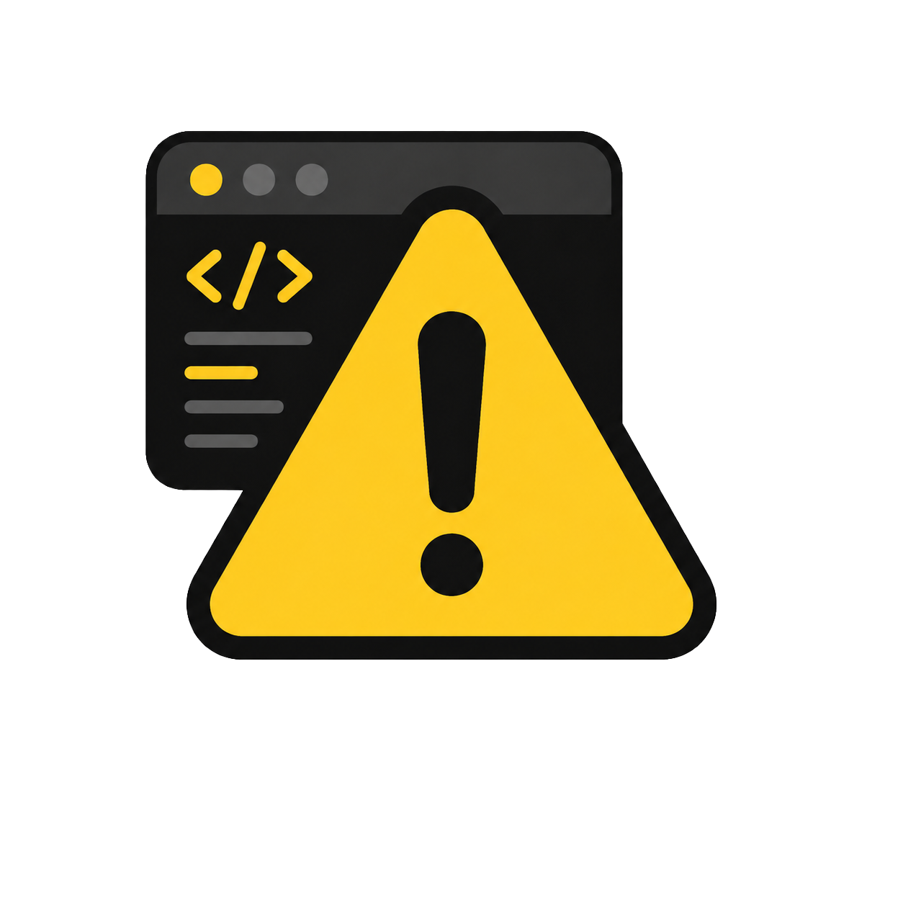
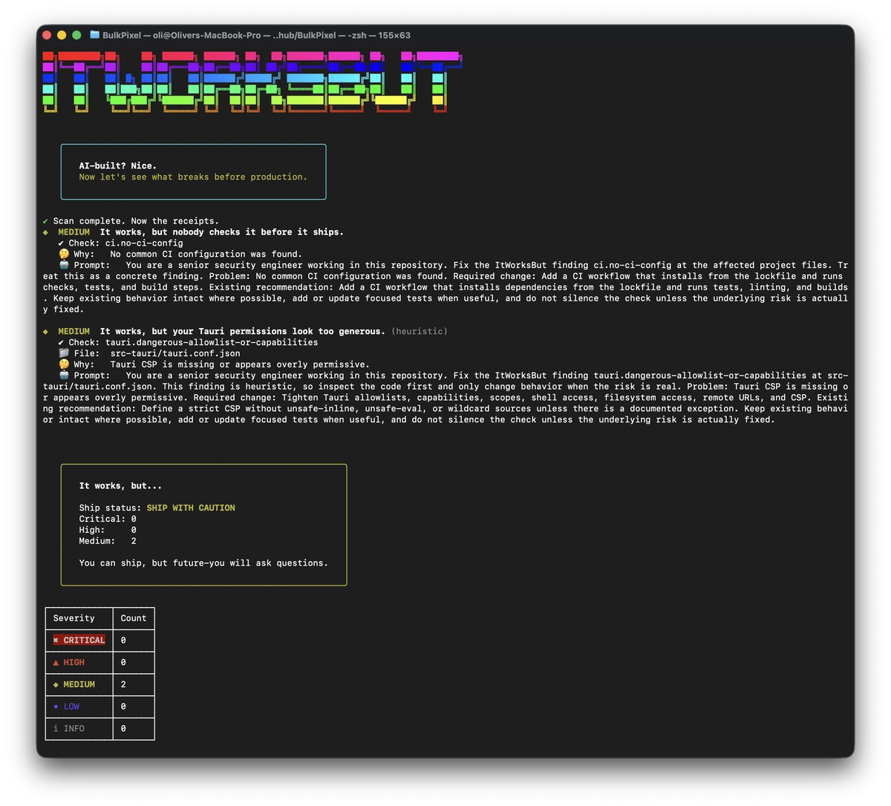

<p align="center">
  
</p>

# ItWorksBut 🔍

[](https://github.com/oliverjessner/ItWorksBut/actions/workflows/dependabot/dependabot-updates) [](https://github.com/oliverjessner/ItWorksBut/actions/workflows/itworksbut.yml)

ItWorksBut is a command-line checker for JavaScript, web, Node.js, Tauri, and Electron projects.
It flags common security and project hygiene risks that are easy to miss in a working prototype.
Every finding includes a ready-to-copy fix prompt for your coding agent.



Run a scan from your project folder, review the findings by severity, and hand the fix prompts to your coding agent.
Export a task list or report when you want to work through issues or share the results.
Findings identify potential problems for review; a clean scan does not guarantee that a project is secure.

## What it does

- Flag potentially exposed secrets, committed environment files, and unsafe logging.
- Check dependency lockfiles, install scripts, and outdated packages.
- Identify risky API, authentication, database, and browser patterns.
- Review Electron and Tauri permissions and common gaps in CI checks.
- Generate prioritized fix lists, Markdown reports, JSON, and SARIF output.
- Discover API endpoints and run controlled load tests against authorized targets.

## Install

Use npm on macOS, Linux, or Windows with Node.js 26 or later.
Git must be available for checks involving tracked and ignored files.

### Homebrew

On macOS or Linux with Homebrew:

```sh
brew install oliverjessner/tap/itworksbut
```

### npm

```sh
npm install --global itworksbut
```

## CLI

Scan the current project and save a prioritized fix list for your coding agent:

```sh
itworksbut scan --todo
```

See the [CLI documentation](docs/CLI.md) for all commands and options.

## Turn findings into fixes

Each finding explains the issue, points to the affected location when available, and provides a fix prompt.
Save a `todo.md` with tasks ordered by severity and acceptance criteria for reviewing the changes.

## Review and share results

Read the severity summary in your terminal or save a Markdown report for later review.
Use JSON or SARIF output and a configurable severity threshold to include scans in automated checks.

## Check API behavior under load

Discover routes in your project and measure response times and errors for eligible GET and HEAD endpoints.
Adjust the load and duration, then save a stress report; external targets require an explicit authorization flag.

## Who it is for

- People building JavaScript prototypes with coding agents.
- Web and desktop app authors reviewing common risks before shipping.
- Teams adding repeatable project checks and shareable findings to their workflow.

## Changelog

See the [changelog](docs/changelog.md) for release notes and changes.

## License

MIT
